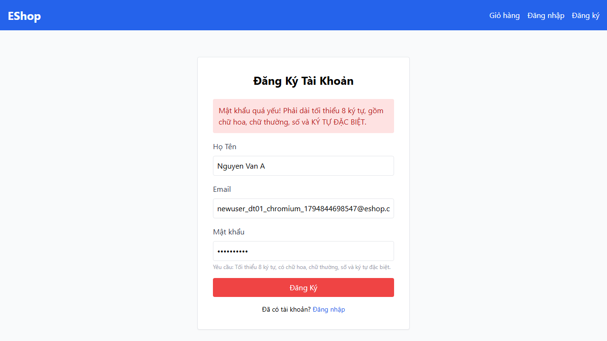
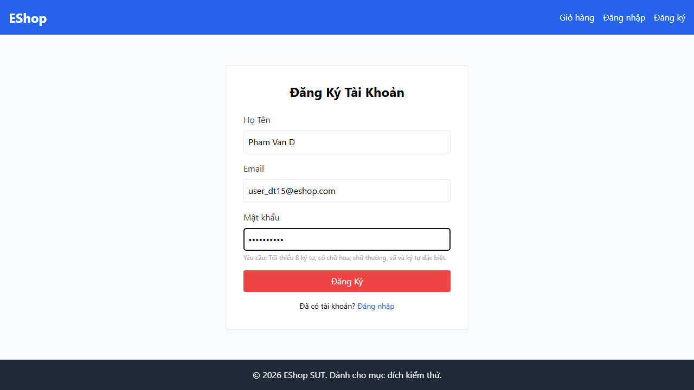
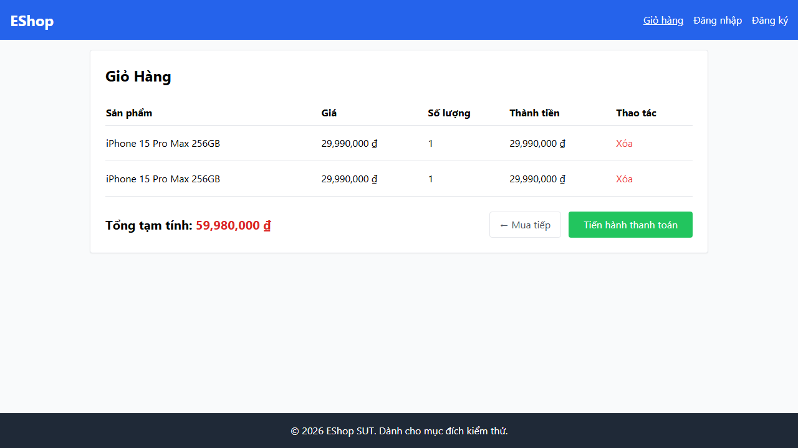
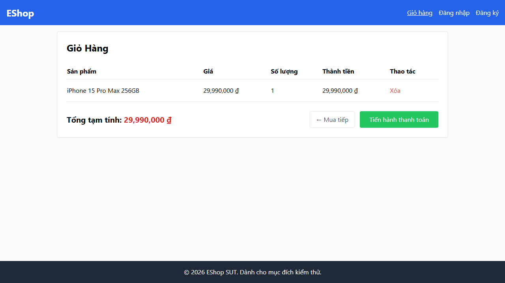
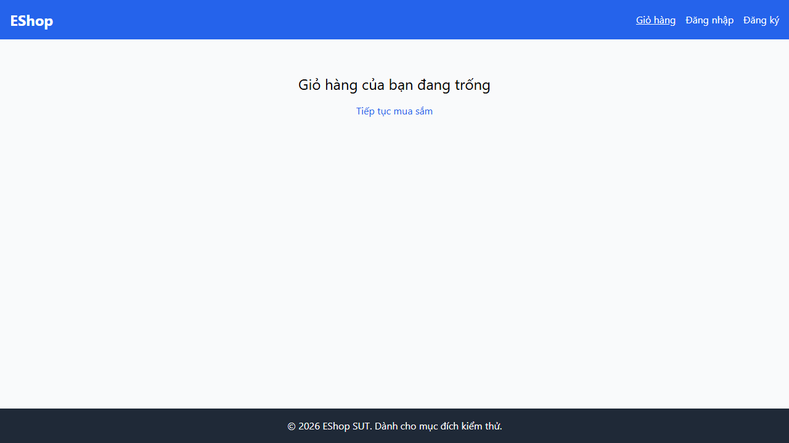
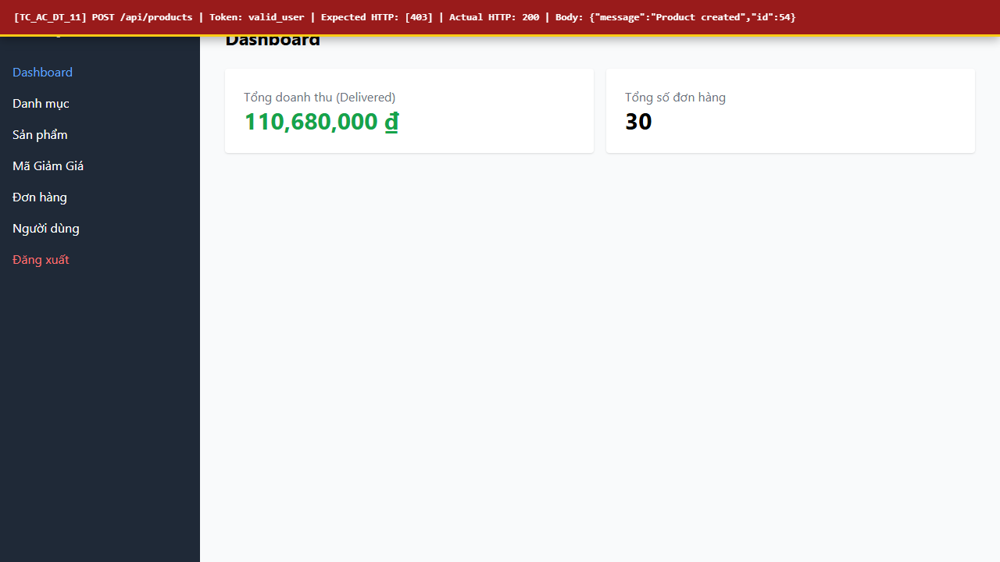
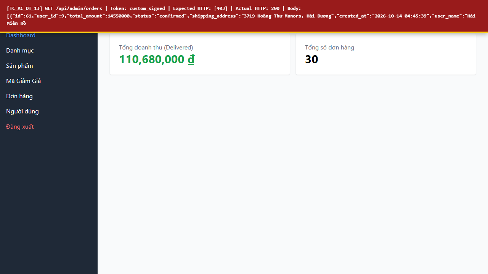

# BÁO CÁO LỖI HỆ THỐNG ESHOP (AUTOMATED BUG REPORT — HW04)

- **Họ và tên sinh viên:** VĂN ĐỨC TUẤN
- **MSSV:** `23120397`
- **Hệ thống kiểm thử (SUT):** EShop Web (`http://localhost:5173`), Web Admin (`http://localhost:5174`), Backend API (`http://localhost:3000`)
- **Công cụ phát hiện:** Playwright 1.64.1 (`Chromium`, `Firefox`, `WebKit`)
- **GitHub Repository:** `https://github.com/vdt12a11/HW04`
- **GitHub Issues Page:** `https://github.com/vdt12a11/HW04/issues` (Issues `#1` $\rightarrow$ `#13`)
- **Tổng số lỗi phát hiện qua bộ kịch bản tự động:** **13 Bugs** (`FR-01`: 2 bugs, `FR-07`: 6 bugs, `FR-12`: 5 bugs)

---

## 1. Bảng Tổng Hợp Danh Sách Lỗi (Bug Summary Table)

| Mã Bug | GitHub Issue | Tính năng | Test Case Phát Hiện | Tiêu đề Lỗi (Summary) | Mức độ (Severity) |
| :---: | :---: | :---: | :---: | :--- | :---: |
| **BUG_FR01_01** | [Issue #1](https://github.com/vdt12a11/HW04/issues/1) | `FR-01` | `TC_DT_01`, `TC_BVA_02`, `TC_BVA_03` | Biểu thức chính quy kiểm tra mật khẩu trong `Register.jsx` dùng `\s` thay vì ký tự đặc biệt khiến mọi mật khẩu mạnh hợp lệ bị từ chối | **Critical** |
| **BUG_FR01_02** | [Issue #2](https://github.com/vdt12a11/HW04/issues/2) | `FR-01` | `TC_DT_15` | Form Đăng ký (`/register`) thiếu hoàn toàn trường "Xác nhận mật khẩu" theo đặc tả `FR-01` | **Major** |
| **BUG_FR07_01** | [Issue #3](https://github.com/vdt12a11/HW04/issues/3) | `FR-07` | `TC_CART_DT_02` | Thêm cùng một sản phẩm đã có trong giỏ hàng tạo dòng mới thay vì cộng dồn số lượng trên dòng hiện có | **Major** |
| **BUG_FR07_02** | [Issue #4](https://github.com/vdt12a11/HW04/issues/4) | `FR-07` | `TC_CART_DT_03`, `TC_CART_DT_05`, `TC_CART_BVA_01` | Bảng giỏ hàng (`/cart`) thiếu hai nút `+` và `-` để điều chỉnh tăng/giảm số lượng sản phẩm | **Major** |
| **BUG_FR07_03** | [Issue #5](https://github.com/vdt12a11/HW04/issues/5) | `FR-07` | `TC_CART_DT_06` | Bấm nút "Xóa" trong giỏ hàng xóa thẳng sản phẩm mà không hiển thị Hộp thoại xác nhận (Confirmation Dialog) | **Major** |
| **BUG_FR07_04** | [Issue #6](https://github.com/vdt12a11/HW04/issues/6) | `FR-07` | `TC_CART_DT_09` | Giao diện Giỏ hàng trống (Empty State) thiếu hình minh họa (`` / `<svg>`) theo đặc tả `FR-07` | **Minor** |
| **BUG_FR07_05** | [Issue #7](https://github.com/vdt12a11/HW04/issues/7) | `FR-07` | `TC_CART_DT_11` | Nhãn tổng tiền giỏ hàng hiển thị sai thành `"Tổng tạm tính:"` thay vì `"Tổng cộng:"` | **Minor** |
| **BUG_FR07_06** | [Issue #8](https://github.com/vdt12a11/HW04/issues/8) | `FR-07` | `TC_CART_DT_12` | Tiêu đề cột thứ 2 ghi `"Giá"` thay vì `"Đơn giá"` và nút quay về ghi `"← Mua tiếp"` thay vì `"Tiếp tục mua sắm"` | **Minor** |
| **BUG_FR12_01** | [Issue #9](https://github.com/vdt12a11/HW04/issues/9) | `FR-12` | `TC_AC_DT_09` | Lỗ hổng phân quyền (`SEC-03`): Người dùng thường (`role='user'`) gọi được `GET /api/admin/users` (`200 OK`) và xem được Dashboard Admin | **Critical** |
| **BUG_FR12_02** | [Issue #10](https://github.com/vdt12a11/HW04/issues/10) | `FR-12` | `TC_AC_DT_10` | Lỗ hổng phân quyền (`SEC-03`): Người dùng thường (`role='user'`) không bị chặn `403 Forbidden` khi gọi `PUT /api/admin/orders/:id/status` | **Critical** |
| **BUG_FR12_03** | [Issue #11](https://github.com/vdt12a11/HW04/issues/11) | `FR-12` | `TC_AC_DT_11` | Lỗ hổng xác thực & phân quyền (`SEC-02`/`SEC-03`): `POST /api/products` không có middleware bảo vệ, cho phép tạo sản phẩm trái phép (`200 OK`) | **Critical** |
| **BUG_FR12_04** | [Issue #12](https://github.com/vdt12a11/HW04/issues/12) | `FR-12` | `TC_AC_DT_13` | Lỗ hổng kiểm tra JWT (`SEC-03`): Token hợp lệ nhưng thiếu trường `role` trong payload vẫn truy cập được `GET /api/admin/orders` (`200 OK`) | **Major** |
| **BUG_FR12_05** | [Issue #13](https://github.com/vdt12a11/HW04/issues/13) | `FR-12` | `TC_AC_DT_14` | Lỗ hổng phân quyền (`SEC-03`): Token mang vai trò không xác định (`role='guest'`) vẫn truy cập được `GET /api/admin/users` (`200 OK`) | **Major** |

---

## 2. Chi Tiết Từng Lỗi & Bằng Chứng Ảnh Chụp Màn Hình (Detailed Bug Reports)

### 2.1. Nhóm Lỗi Feature A — `FR-01: Account Registration`

#### 🔴 `BUG_FR01_01`: Biểu thức chính quy kiểm tra mật khẩu từ chối mọi mật khẩu chứa ký tự đặc biệt hợp lệ
- **Test Cases phát hiện:** `TC_DT_01`, `TC_BVA_02`, `TC_BVA_03`
- **Mức độ nghiêm trọng (Severity):** Critical | **Độ ưu tiên (Priority):** High
- **Các bước tái hiện (Steps to Reproduce):**
  1. Mở trang Đăng ký tài khoản tại `http://localhost:5173/register`.
  2. Nhập `Họ Tên = "Nguyen Van A"`, `Email = "newuser_dt01@eshop.com"`, `Mật khẩu = "Aa1@$!%*?&"` (hoặc `"Esho@123"`, `"Eshop@123"`).
  3. Bấm nút **Đăng Ký**.
- **Kết quả mong đợi (Expected Result):** Mật khẩu thỏa mãn đủ 5 điều kiện của `FR-01` ($\ge 8$ ký tự, có chữ hoa, chữ thường, chữ số và ký tự đặc biệt thuộc `[@$!%*?&]`), hệ thống tạo tài khoản và chuyển hướng sang `/login`.
- **Kết quả thực tế & Nguyên nhân gốc rễ (Actual Result & Root Cause):**
  - Hệ thống từ chối đăng ký và hiện thông báo lỗi: *"Mật khẩu quá yếu! Phải dài tối thiểu 8 ký tự, gồm chữ hoa, chữ thường, số và KÝ TỰ ĐẶC BIỆT."*
  - **Root Cause:** Tại `frontend-web/src/pages/Register.jsx` (dòng 15), regex được viết là `/^(?=.*[a-z])(?=.*[A-Z])(?=.*\d)(?=.*\s)[A-Za-z\d\s]{8,}$/` — dùng `\s` (khoảng trắng) thay vì tập ký tự đặc biệt `[@$!%*?&]`.
- **Ảnh chụp màn hình (Screenshot):**

---

#### 🟠 `BUG_FR01_02`: Form Đăng ký thiếu trường "Xác nhận mật khẩu" (Confirm Password)
- **Test Case phát hiện:** `TC_DT_15`
- **Mức độ nghiêm trọng (Severity):** Major | **Độ ưu tiên (Priority):** High
- **Các bước tái hiện (Steps to Reproduce):**
  1. Mở trang `http://localhost:5173/register`.
  2. Kiểm tra các trường nhập liệu trong `<form>`.
- **Kết quả mong đợi (Expected Result):** Theo đặc tả `FR-01`: *"Phải có trường Xác nhận mật khẩu — hệ thống từ chối nếu hai trường không khớp."*
- **Kết quả thực tế & Nguyên nhân gốc rễ (Actual Result & Root Cause):**
  - Giao diện `/register` chỉ có 3 ô nhập (`Họ Tên`, `Email`, `Mật khẩu`), hoàn toàn không có ô nhập `Xác nhận mật khẩu`.
- **Ảnh chụp màn hình (Screenshot):**

---

### 2.2. Nhóm Lỗi Feature B — `FR-07: Shopping Cart`

#### 🟠 `BUG_FR07_01`: Thêm cùng một sản phẩm đã có trong giỏ tạo dòng mới thay vì tăng số lượng
- **Test Case phát hiện:** `TC_CART_DT_02`
- **Mức độ nghiêm trọng (Severity):** Major | **Độ ưu tiên (Priority):** High
- **Các bước tái hiện (Steps to Reproduce):**
  1. Mở trang chủ `http://localhost:5173/`, bấm nút **Thêm vào giỏ** ở sản phẩm đầu tiên (`iPhone 15 Pro Max`) 2 lần liên tiếp.
  2. Bấm vào liên kết **Giỏ hàng** trên thanh điều hướng Header để tới `/cart`.
- **Kết quả mong đợi (Expected Result):** Theo đặc tả `FR-07`: *"Thêm cùng một sản phẩm vào giỏ sẽ tăng số lượng, không tạo dòng mới"* (Bảng chỉ có 1 dòng với `Số lượng = 2`).
- **Kết quả thực tế & Nguyên nhân gốc rễ (Actual Result & Root Cause):**
  - Bảng giỏ hàng tạo thành **2 dòng riêng biệt** cho cùng một sản phẩm, mỗi dòng có `Số lượng = 1`.
  - **Root Cause:** Trong `frontend-web/src/context/CartContext.jsx` (dòng 8–10), hàm `addToCart` gọi thẳng `setCart([...cart, { ...product, quantity }])` mà không kiểm tra `product.id` đã tồn tại trong mảng `cart` hay chưa.
- **Ảnh chụp màn hình (Screenshot):**

---

#### 🟠 `BUG_FR07_02`: Cột Số lượng trong bảng Giỏ hàng thiếu nút `+` và `-` để điều chỉnh số lượng
- **Test Cases phát hiện:** `TC_CART_DT_03`, `TC_CART_DT_05`, `TC_CART_BVA_01`
- **Mức độ nghiêm trọng (Severity):** Major | **Độ ưu tiên (Priority):** High
- **Các bước tái hiện (Steps to Reproduce):**
  1. Thêm một sản phẩm vào giỏ và điều hướng tới `/cart`.
  2. Quan sát cột **Số lượng** trên dòng sản phẩm.
- **Kết quả mong đợi (Expected Result):** Theo đặc tả `FR-07`: Cột **Số lượng** phải có nút `+` và `-` để tăng/giảm số lượng và chặn giảm dưới biên $Q = 1$.
- **Kết quả thực tế & Nguyên nhân gốc rễ (Actual Result & Root Cause):**
  - Tại `frontend-web/src/pages/Cart.jsx` (dòng 47), cột số lượng chỉ render văn bản tĩnh `<td>{item.quantity}</td>`, thiếu hoàn toàn hai nút `+` và `-`.
- **Ảnh chụp màn hình (Screenshot):**

---

#### 🟠 `BUG_FR07_03`: Bấm nút "Xóa" trong giỏ hàng xóa thẳng sản phẩm không qua Hộp thoại xác nhận
- **Test Case phát hiện:** `TC_CART_DT_06`
- **Mức độ nghiêm trọng (Severity):** Major | **Độ ưu tiên (Priority):** Medium
- **Các bước tái hiện (Steps to Reproduce):**
  1. Thêm một sản phẩm vào giỏ và mở `/cart`.
  2. Bấm vào nút **Xóa** màu đỏ tại cột **Thao tác**.
- **Kết quả mong đợi (Expected Result):** Theo đặc tả `FR-07`: *"Nút Xóa sản phẩm phải có dialog xác nhận trước khi thực hiện."*
- **Kết quả thực tế & Nguyên nhân gốc rễ (Actual Result & Root Cause):**
  - Sản phẩm bị xóa ngay lập tức khỏi giỏ hàng mà không hiển thị `window.confirm` hay modal xác nhận nào (`Cart.jsx` dòng 51 gọi trực tiếp `onClick={() => removeFromCart(index)}`).
- **Ảnh chụp màn hình (Screenshot):**

---

#### 🟡 `BUG_FR07_04`: Giao diện Giỏ hàng trống (Empty State) thiếu hình minh họa
- **Test Case phát hiện:** `TC_CART_DT_09`
- **Mức độ nghiêm trọng (Severity):** Minor | **Độ ưu tiên (Priority):** Low
- **Các bước tái hiện (Steps to Reproduce):**
  1. Mở trang `/cart` khi chưa thêm sản phẩm nào vào giỏ.
- **Kết quả mong đợi (Expected Result):** Theo đặc tả `FR-07`: *"Giỏ hàng trống phải có hình minh họa và thông báo rõ ràng."*
- **Kết quả thực tế & Nguyên nhân gốc rễ (Actual Result & Root Cause):**
  - `Cart.jsx` (dòng 20–26) chỉ hiển thị thẻ `<h2>Giỏ hàng của bạn đang trống</h2>` và link `Tiếp tục mua sắm`, thiếu hoàn toàn hình minh họa (`` hoặc `<svg>`).
- **Ảnh chụp màn hình (Screenshot):**

---

#### 🟡 `BUG_FR07_05`: Nhãn tổng tiền hiển thị sai thành "Tổng tạm tính" thay vì "Tổng cộng"
- **Test Case phát hiện:** `TC_CART_DT_11`
- **Mức độ nghiêm trọng (Severity):** Minor | **Độ ưu tiên (Priority):** Low
- **Các bước tái hiện (Steps to Reproduce):**
  1. Thêm ít nhất 1 sản phẩm vào giỏ và mở `/cart`.
  2. Quan sát nhãn tổng tiền phía dưới bảng giỏ hàng.
- **Kết quả mong đợi (Expected Result):** Theo đặc tả `FR-07`: *"Tổng tiền hiển thị nhãn chính xác: 'Tổng cộng' (không phải 'Tổng tạm tính')."*
- **Kết quả thực tế & Nguyên nhân gốc rễ (Actual Result & Root Cause):**
  - `Cart.jsx` (dòng 63) hiển thị `"Tổng tạm tính:"`.
- **Ảnh chụp màn hình (Screenshot):**

---

#### 🟡 `BUG_FR07_06`: Sai tiêu đề cột "Giá" (thay vì "Đơn giá") và sai nhãn nút "← Mua tiếp" (thay vì "Tiếp tục mua sắm")
- **Test Case phát hiện:** `TC_CART_DT_12`
- **Mức độ nghiêm trọng (Severity):** Minor | **Độ ưu tiên (Priority):** Low
- **Các bước tái hiện (Steps to Reproduce):**
  1. Thêm ít nhất 1 sản phẩm vào giỏ và mở `/cart`.
  2. Quan sát tiêu đề cột thứ 2 của bảng và nút điều hướng quay lại trang chủ.
- **Kết quả mong đợi (Expected Result):** Theo đặc tả `FR-07`: Cột thứ 2 phải ghi **"Đơn giá"** và nút quay về phải ghi **"Tiếp tục mua sắm"**.
- **Kết quả thực tế & Nguyên nhân gốc rễ (Actual Result & Root Cause):**
  - `Cart.jsx` (dòng 36 & 67) ghi tiêu đề cột là `"Giá"` và nút quay về là `"← Mua tiếp"`.
- **Ảnh chụp màn hình (Screenshot):**

---

### 2.3. Nhóm Lỗi Feature C — `FR-12: Access Control`

#### 🔴 `BUG_FR12_01`: Người dùng thường (`role='user'`) truy cập được API `GET /api/admin/users` và mở được Dashboard Admin
- **Test Case phát hiện:** `TC_AC_DT_09`
- **Mức độ nghiêm trọng (Severity):** Critical | **Độ ưu tiên (Priority):** High
- **Các bước tái hiện (Steps to Reproduce):**
  1. Sử dụng JWT Token hợp lệ của tài khoản thường (`role = 'user'`, `id = 2`).
  2. Gửi request `GET http://localhost:3000/api/admin/users` kèm header `Authorization: Bearer <user_token>` và mở `http://localhost:5174` với `adminToken` này.
- **Kết quả mong đợi (Expected Result):** Theo đặc tả `FR-12` (`SEC-03`), hệ thống phải trả về **`403 Forbidden`** và chặn truy cập dữ liệu người dùng.
- **Kết quả thực tế & Nguyên nhân gốc rễ (Actual Result & Root Cause):**
  - API trả về **`200 OK`** kèm danh sách toàn bộ người dùng trong CSDL, đồng thời giao diện Web Admin (`localhost:5174`) mở khóa toàn bộ Dashboard!
  - **Root Cause:** Middleware `authenticateToken` trong `backend/server.js` (dòng 109–119) chỉ kiểm tra chữ ký JWT hợp lệ mà hoàn toàn thiếu middleware `requireAdmin` kiểm tra `req.user.role === 'admin'`.
- **Ảnh chụp màn hình (Screenshot):**

---

#### 🔴 `BUG_FR12_02`: Người dùng thường (`role='user'`) không bị chặn `403 Forbidden` tại API `PUT /api/admin/orders/:id/status`
- **Test Case phát hiện:** `TC_AC_DT_10`
- **Mức độ nghiêm trọng (Severity):** Critical | **Độ ưu tiên (Priority):** High
- **Các bước tái hiện (Steps to Reproduce):**
  1. Gửi request `PUT http://localhost:3000/api/admin/orders/99999/status` kèm token của `role = 'user'` và body `{"status": "confirmed"}`.
- **Kết quả mong đợi (Expected Result):** Phải bị chặn ngay tại tầng middleware phân quyền với mã **`403 Forbidden`**.
- **Kết quả thực tế & Nguyên nhân gốc rễ (Actual Result & Root Cause):**
  - Request đi xuyên qua tầng bảo vệ vào tận controller xử lý đơn hàng (trả về `404 Order not found` thay vì `403 Forbidden`), cho phép `role = 'user'` thay đổi trạng thái đơn hàng bất kỳ.
- **Ảnh chụp màn hình (Screenshot):**

---

#### 🔴 `BUG_FR12_03`: Endpoint `POST /api/products` thiếu hoàn toàn kiểm soát truy cập, cho phép tạo sản phẩm trái phép
- **Test Case phát hiện:** `TC_AC_DT_11`
- **Mức độ nghiêm trọng (Severity):** Critical | **Độ ưu tiên (Priority):** High
- **Các bước tái hiện (Steps to Reproduce):**
  1. Dùng token `role = 'user'` gửi request `POST http://localhost:3000/api/products` với payload `{"name": "SP Hacker Unauthorized", "price": 1000, "category_id": 1}`.
- **Kết quả mong đợi (Expected Result):** Phải bị từ chối với mã **`403 Forbidden`**.
- **Kết quả thực tế & Nguyên nhân gốc rễ (Actual Result & Root Cause):**
  - Server trả về **`200 OK`** (`{"message": "Product created", "id": ...}`) vì tại `backend/server.js` (dòng 176), route `app.post("/api/products", ...)` không gắn cả `authenticateToken` lẫn kiểm tra quyền `admin`.
- **Ảnh chụp màn hình (Screenshot):**

---

#### 🟠 `BUG_FR12_04`: Token JWT hợp lệ nhưng không chứa thuộc tính `role` vẫn truy cập được `GET /api/admin/orders`
- **Test Case phát hiện:** `TC_AC_DT_13`
- **Mức độ nghiêm trọng (Severity):** Major | **Độ ưu tiên (Priority):** High
- **Các bước tái hiện (Steps to Reproduce):**
  1. Ký một JWT hợp lệ chỉ có payload `{"id": 1}` (không có trường `role`).
  2. Gọi `GET http://localhost:3000/api/admin/orders` kèm token này.
- **Kết quả mong đợi (Expected Result):** Hệ thống phải từ chối với mã **`403 Forbidden`** do thiếu khai báo vai trò quản trị.
- **Kết quả thực tế & Nguyên nhân gốc rễ (Actual Result & Root Cause):**
  - Hệ thống trả về **`200 OK`** kèm toàn bộ danh sách đơn hàng của hệ thống.
- **Ảnh chụp màn hình (Screenshot):**

---

#### 🟠 `BUG_FR12_05`: Token JWT mang vai trò lạ (`role='guest'`) vẫn truy cập được `GET /api/admin/users`
- **Test Case phát hiện:** `TC_AC_DT_14`
- **Mức độ nghiêm trọng (Severity):** Major | **Độ ưu tiên (Priority):** High
- **Các bước tái hiện (Steps to Reproduce):**
  1. Ký một JWT hợp lệ có payload `{"id": 1, "role": "guest"}`.
  2. Gọi `GET http://localhost:3000/api/admin/users` kèm token này.
- **Kết quả mong đợi (Expected Result):** Hệ thống phải từ chối với mã **`403 Forbidden`**.
- **Kết quả thực tế & Nguyên nhân gốc rễ (Actual Result & Root Cause):**
  - Hệ thống trả về **`200 OK`** và cho phép mở giao diện Web Admin.
- **Ảnh chụp màn hình (Screenshot):**

